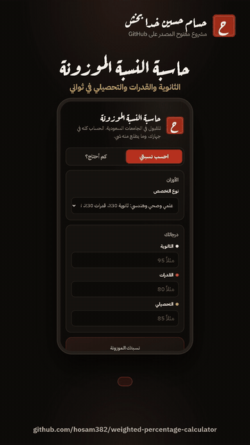

# حاسبة النسبة الموزونة | Weighted Percentage Calculator
**By [Hassam Hussain Khada Bakhsa](https://github.com/hosam382)**

**جرّبها الحين:** https://hosam382.github.io/weighted-percentage-calculator/



احسب نسبتك الموزونة للقبول في الجامعات السعودية من درجة الثانوية والقدرات والتحصيلي، واعرف **كم تحتاج** في التحصيلي (أو القدرات) عشان توصل النسبة اللي تبيها.

## وش تسوي
- **احسب نسبتي:** تكتب درجاتك وتطلع نسبتك الموزونة مع توضيح كم أعطاك كل جزء.
- **كم أحتاج؟:** تكتب النسبة اللي تبيها، وتعرف كم تحتاج في الجزء الباقي، وتقولك إذا الهدف مستحيل بهذي الأوزان.
- **أوزان جامعتي:** تقدر تدخل أوزان أي جامعة بنفسك.
- **رابط للمشاركة:** زر ينسخ رابط فيه درجاتك عشان ترسله لأحد.
- تقبل الأرقام العربية (٩٥) والإنجليزية (95).

## الأوزان
| النوع | الثانوية | القدرات | التحصيلي |
|---|---|---|---|
| علمي وصحي وهندسي (الأشهر) | 30% | 30% | 40% |
| نظري وإداري | 50% | 50% | 0% |

> **تنبيه:** هذي صيغ شائعة وليست رسمية. كل جامعة تعلن أوزانها في دليل القبول وتتغير من سنة لسنة، فتأكد من موقع الجامعة واستخدم «أوزان جامعتي».

## الخصوصية
الحساب كله في جهازك. ما فيه سيرفر، ولا تحليلات، ولا خطوط من برّا. حتى الخطوط محفوظة داخل المشروع.

## تشغيل الاختبارات
```bash
node --test
```
منطق الحساب في `calc.js` ومنفصل عن الصفحة، وعليه 9 اختبارات في `calc.test.js`.

## English
A small, privacy-friendly calculator for the Saudi university admission "weighted percentage" (high school GPA + Qudrat + Tahsili), with a reverse mode that tells you the score you need to reach a target. Pure logic lives in `calc.js` (tested with `node --test`), the UI is plain HTML/CSS/JS with no dependencies.

بُني بمساعدة الذكاء الاصطناعي (Claude) وراجعه حسام.
Built with AI assistance (Claude), reviewed by Hassam.

## License
MIT
